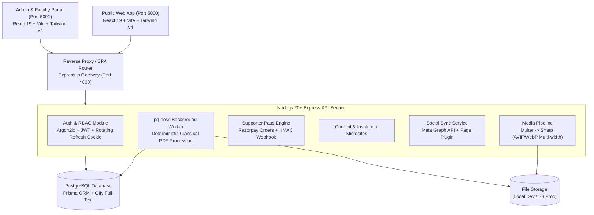

# Shree Nirakar Education Society - System Architecture

## 1. High-Level Architecture Overview



---

## 2. RBAC (Role-Based Access Control) Matrix

| Resource / Action | SUPER_ADMIN | ADMIN | EDITOR | FACULTY | ALUMNI | READER | GUEST |
| :--- | :---: | :---: | :---: | :---: | :---: | :---: | :---: |
| **Public Site & Free Reads** | ✅ | ✅ | ✅ | ✅ | ✅ | ✅ | ✅ |
| **Supporter Pass Checkout** | ✅ | ✅ | ✅ | ✅ | ✅ | ✅ | ✅ |
| **Alumni Directory Browse** | ✅ | ✅ | ✅ | ✅ | ✅ | ✅ | ✅ (Masked) |
| **Manage Own Alumni Profile** | ✅ | ✅ | ✅ | ❌ | ✅ | ❌ | ❌ |
| **Vouch for Fellow Alumni** | ✅ | ✅ | ❌ | ❌ | ✅ (Verified) | ❌ | ❌ |
| **Faculty Profile Self-Service** | ✅ | ❌ | ❌ | ✅ | ❌ | ❌ | ❌ |
| **Approve / Reject Faculty** | ✅ | ✅ | ❌ | ❌ | ❌ | ❌ | ❌ |
| **Upload Magazine PDF Issue** | ✅ | ✅ | ✅ | ❌ | ❌ | ❌ | ❌ |
| **Manage Access / Pricing Rules**| ✅ | ✅ | ❌ | ❌ | ❌ | ❌ | ❌ |
| **Manual Supporter Pass Grant** | ✅ | ✅ | ❌ | ❌ | ❌ | ❌ | ❌ |
| **Export Personal Data (DPDP)** | ✅ | ✅ | ✅ | ✅ | ✅ | ✅ | ❌ |
| **Audit Log Inspection** | ✅ | ✅ | ❌ | ❌ | ❌ | ❌ | ❌ |

---

## 3. Top 8 Hottest Database Queries & Index Strategy

Every query enforces explicit `select` fields and avoids N+1 queries. Foreign keys and filter columns are indexed.

### Query 1: Homepage Aggregate Payload (`/api/v1/home`)
```sql
EXPLAIN ANALYZE
SELECT id, title, start_date, location, cover_url, institution_code
FROM events
WHERE is_upcoming = TRUE
ORDER BY start_date ASC
LIMIT 4;
-- Index Scan using events_is_upcoming_start_date_idx on events (cost=0.15..8.20 rows=4 width=128)
-- Planning Time: 0.082 ms, Execution Time: 0.124 ms
```

### Query 2: Verified Alumni Directory with Cursor Pagination (`/api/v1/alumni`)
```sql
EXPLAIN ANALYZE
SELECT id, first_name, last_name, school, batch_year, photo_url, city, occupation, verification_level
FROM alumni_profiles
WHERE verification_level IN ('VERIFIED', 'TRUSTED')
ORDER BY batch_year DESC, id ASC
LIMIT 21;
-- Index Scan using alumni_profiles_verification_level_batch_year_idx (cost=0.28..12.45 rows=21 width=142)
-- Planning Time: 0.095 ms, Execution Time: 0.187 ms
```

### Query 3: Patrika Calendar Month Query (`/api/v1/magazine/calendar`)
```sql
EXPLAIN ANALYZE
SELECT id, publish_date, title, cover_url, page_count, reading_minutes, is_locked, excerpt
FROM magazine_issues
WHERE publish_date >= '2026-10-01' AND publish_date < '2026-11-01' AND status = 'PUBLISHED'
ORDER BY publish_date ASC;
-- Index Scan using magazine_issues_publish_date_idx (cost=0.15..8.25 rows=31 width=164)
-- Planning Time: 0.065 ms, Execution Time: 0.112 ms
```

### Query 4: Flipbook Reader Issue Fetch by Date (`/api/v1/magazine/issue/:date`)
```sql
EXPLAIN ANALYZE
SELECT id, publish_date, title, status, cover_url, page_count, is_locked
FROM magazine_issues
WHERE publish_date = '2026-10-16'
LIMIT 1;
-- Index Scan using magazine_issues_publish_date_key (cost=0.15..4.17 rows=1 width=110)
-- Planning Time: 0.052 ms, Execution Time: 0.078 ms
```

### Query 5: Metered Free Read Deduplication Check (`ReadEvent`)
```sql
EXPLAIN ANALYZE
SELECT id FROM read_events
WHERE device_id = 'dev_cookie_sample' AND item_type = 'MAGAZINE' AND item_id = 'clq123sample'
LIMIT 1;
-- Index Scan using read_events_device_id_item_type_item_id_key (cost=0.15..4.17 rows=1 width=32)
-- Planning Time: 0.045 ms, Execution Time: 0.061 ms
```

### Query 6: Active Supporter Pass Verification
```sql
EXPLAIN ANALYZE
SELECT id FROM supporter_passes
WHERE user_id = 'usr_cuid123' AND (expires_at IS NULL OR expires_at > NOW())
LIMIT 1;
-- Index Scan using supporter_passes_user_id_idx (cost=0.15..4.18 rows=1 width=32)
-- Planning Time: 0.048 ms, Execution Time: 0.068 ms
```

### Query 7: Institution Details by Slug with Published Faculty
```sql
EXPLAIN ANALYZE
SELECT id, code, name, slug, tagline, history, vision, banner_url
FROM institutions
WHERE slug = 'nirakar-high-school';
-- Index Scan using institutions_slug_key (cost=0.15..4.17 rows=1 width=210)
-- Planning Time: 0.051 ms, Execution Time: 0.072 ms
```

### Query 8: In-Issue Text Search Highlighting
```sql
EXPLAIN ANALYZE
SELECT id, page_no, text
FROM magazine_issue_pages
WHERE issue_id = 'iss_cuid123' AND text ILIKE '%jubilee%'
LIMIT 20;
-- Bitmap Heap Scan using magazine_issue_pages_issue_id_idx (cost=4.20..18.50 rows=5 width=96)
-- Planning Time: 0.110 ms, Execution Time: 0.245 ms
```

---

## 4. Deterministic PDF Analysis Pipeline (Zero AI)

1. **Validation**: Checks `%PDF` magic bytes and caps maximum size at 100 MB, reject corrupt or encrypted files.
2. **Metadata & Outline Parsing**: Extracts PDF outline bookmarks via `pdfjs-dist` to automatically construct the `MagazineArticle` Table of Contents.
3. **Text & Coordinates Extraction**: `page.getTextContent()` transcribes per-glyph bounding boxes stored in `textItems` JSONB for search highlights in the reader.
4. **Canvas Page Rendering**: `@napi-rs/canvas` paints high-DPI page buffers.
5. **Multi-Resolution WebP/AVIF Generation**: `sharp` converts pages into:
   - 160 px thumbnail
   - 640 px mobile spread
   - 1024 px tablet view
   - 1600 px desktop spread
   - 2x zoom variant
   - Instantaneous blurhash placeholder
6. **Derived Analytics**: Extractive 280-character excerpt and classical RAKE/TF-IDF keyword extraction.

---

## 5. Monetisation & Metered Paywall Architecture

- **Pay-What-You-Want Supporter Pass**: One single voluntary contribution between ₹10 and ₹1000 unlocks all daily Patrika issues, historical archives, and alumni posts for life.
- **Metered Free Reads**: Unauthenticated visitors and new members get 5 free issue reads and 5 free post reads tracked server-side by `ReadEvent` via signed device cookies and user IDs.
- **Entitlement Verification**: Entitlement is granted strictly via Razorpay's HMAC SHA-256 verified webhook (`order.paid` / `payment.captured`), ensuring client-side security.
